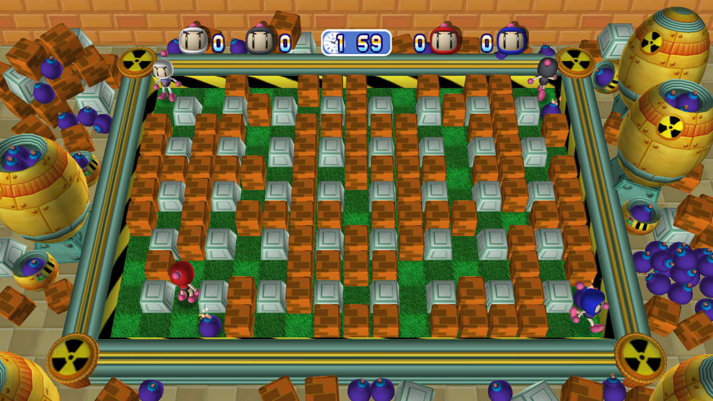
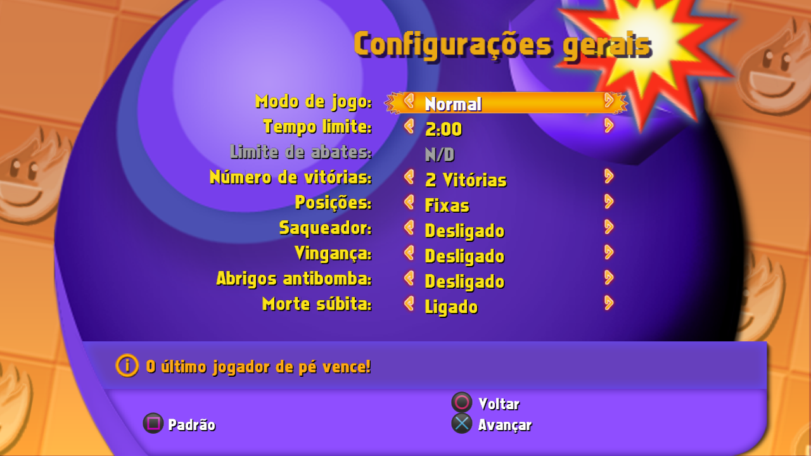

# Bomberman ULTRA — port não oficial para PC

Port nativo para Windows do **Bomberman ULTRA** (PlayStation Network, Hudson Soft, 2009), feito por recompilação estática: o código PowerPC e SPU do PS3 é convertido em C/C++ e compilado para x86-64, com o sistema do PS3 substituído por uma camada HLE ([ps3recomp](https://github.com/sp00nznet/ps3recomp)). Não é um emulador.

> **Não afiliado, endossado nem patrocinado pela Konami, Hudson Soft ou Sony Interactive Entertainment.** Bomberman é marca registrada da Konami Digital Entertainment. PlayStation é marca registrada da Sony Interactive Entertainment. **Este repositório não contém nenhum arquivo do jogo** — nem código, nem arte, nem áudio, nem texto, nem licença. Você precisa ter o seu próprio jogo.

[English](README.en.md) · [Detalhes técnicos](docs/TECNICO.md) · [Mudanças](CHANGELOG.md)



## ⚠ Licença obrigatória: versão europeia

O port foi compilado a partir de **uma versão específica** do jogo e **só funciona com a licença dela**:

| | |
|---|---|
| Jogo | Bomberman ULTRA — **Europa** |
| Title ID | `NPEB00076` |
| Content ID | `EP0555-NPEB00076_00-BOMBERMANGAME001` |
| Licença | `EP0555-NPEB00076_00-BOMBERMANGAME001.rap` |

O arquivo `.rap` é a licença da sua compra na PSN; ele é obtido do seu próprio PS3/conta (as ferramentas para isso não fazem parte deste projeto). O launcher procura o `.rap` sozinho e também tem o botão **Localizar licença**. Sem a licença certa o botão JOGAR fica bloqueado, e o próprio `BombermanUltra.exe` também se recusa a abrir. Outras regiões (EUA `NPUB…`, Japão `NPJB…`) têm outro EBOOT e não funcionam com este port.

## Destaques

- Nativo 64 bits, Vulkan, **60 FPS travados** como no PS3 (o jogo tem a lógica presa ao frame); opção para destravar.
- Resolução de renderização de 720p a 4K, tela cheia sem bordas, contador de FPS.
- **Tradução em português do Brasil** (734 de 736 textos), além dos idiomas originais.
- **Controles**: DualShock 4, DualSense (USB/Bluetooth, vibração, cor do jogador na light bar), Xbox e genéricos, com conexão a quente, até 4 jogadores locais; teclado no jogador 1.
- **Steam / Big Picture**: botão "Adicionar à Steam" no launcher; segure **SELECT + START** para fechar o jogo pelo controle.
- Launcher em português com verificação de arquivos, licença, idioma, áudio e opções de vídeo.
- Saves locais. Sem RPCS3, sem firmware e sem `dev_flash` para jogar.



## Como funciona

1. O `EBOOT.BIN` do seu PKG é decriptado com o seu RAP.
2. O ps3recomp converte as 6.249 funções PPU em C++ e os três programas SPU (áudio MultiStream e dois jobs de renderização) em C.
3. Tudo é compilado com o runtime HLE (`cellGcm`, `cellSpurs`, `cellPad`, sistema de arquivos, saves…) e com um backend Vulkan que executa o RSX: comandos do FIFO, shaders do jogo traduzidos para SPIR-V e texturas DXT.
4. O resultado é um `BombermanUltra.exe` que lê `media.zip` e `Bman.bnk` direto da sua pasta do jogo.

Como o código gerado vem do binário do jogo, **o executável é sempre compilado na sua máquina**, a partir dos seus arquivos. Não distribuímos executáveis prontos.

## Compatibilidade

| | |
|---|---|
| Sistema | Windows 10/11 64 bits (o build roda em Linux ou WSL) |
| Vídeo | qualquer GPU com **Vulkan 1.0** e driver atualizado |
| CPU | x86-64 com AVX2 (versão principal) ou SSE4.2 (versão `compat`, escolhida sozinha pelo launcher) |

**GPUs testadas**:

- **AMD** Radeon RX 580 (Windows 11): jogo completo, 60 FPS.
- **SwiftShader** (Vulkan em software, Linux): boot → partida, imagens conferidas quadro a quadro.

**NVIDIA**: ainda não testado em hardware NVIDIA. Antes de publicar, o backend passou por esta revisão:

- os formatos usados (profundidade D32S8/D24S8, cores, BC1–3) são pedidos ao driver com fallback;
- recursos opcionais (`depthBounds`, `textureCompressionBC`) só são ligados se o driver informar;
- o swapchain usa `minImageCount + 1` e o modo de apresentação é escolhido entre os oferecidos;
- a GPU dedicada é preferida em notebooks híbridos (Optimus);
- todos os shaders gerados durante uma partida validam como SPIR-V para Vulkan 1.0 (só a capability `Shader`);
- `VK_SUBOPTIMAL_KHR` só recria o swapchain quando o tamanho muda de fato (alguns drivers o devolvem quadro a quadro, o que antes causaria travadas).

Se você tem NVIDIA, um relato (funcionou ou não, com o `logs\bomberman.log`) ajuda muito. Se o PC tiver duas GPUs, `PS3RECOMP_VK_DEVICE=<n>` na seção `[env]` do `launcher.ini` força uma delas (os números aparecem no log).

## Instalação

### O que você precisa

- O **seu** PKG do Bomberman ULTRA europeu (`NPEB00076`) e o **seu** RAP `EP0555-NPEB00076_00-BOMBERMANGAME001.rap`.
- Para extrair e decriptar: o [RPCS3](https://rpcs3.net) instalado **ou** o código-fonte dele (as ferramentas daqui leem as chaves de `rpcs3/Crypto/key_vault.h`; nenhuma chave vem neste repositório).
- Para compilar: Linux ou **WSL** (Ubuntu 22.04+), com `git curl cmake ninja-build python3 python3-pip`; `pip install cryptography pillow`.
- Cerca de 2 GB livres; o build completo (as duas versões do exe) levou 11 minutos numa máquina de 2 núcleos.

### Passos

1. **Clone** este repositório e o ps3recomp, lado a lado:
   ```sh
   git clone https://github.com/<seu-usuario>/bomberman-ultra-pc.git
   git clone https://github.com/sp00nznet/ps3recomp.git
   git -C ps3recomp checkout a6d76c895f77eb30b90a806c830544e61821b77f
   ```
2. **Extraia o PKG** para `game/`. Pelo RPCS3: instale o PKG e copie `dev_hdd0/game/NPEB00076/*` para `bomberman-ultra-pc/game/PS3_GAME/`. Ou, pelo script:
   ```sh
   python3 tools/extract_pkg.py NPEB00076.pkg /tmp/pkg --rpcs3-crypto <rpcs3>/rpcs3/Crypto
   mkdir -p game && cp -r /tmp/pkg/NPEB00076 game/PS3_GAME
   ```
3. **Decripte o EBOOT** para `game/PS3_GAME/USRDIR/EBOOT.elf`. No RPCS3: *Utilitários → Decrypt PS3 Binaries* (gera `EBOOT.elf`). Ou:
   ```sh
   python3 tools/unself_npdrm.py game/PS3_GAME/USRDIR/EBOOT.BIN game/PS3_GAME/USRDIR/EBOOT.elf \
       --rap EP0555-NPEB00076_00-BOMBERMANGAME001.rap --rpcs3-crypto <rpcs3>/rpcs3/Crypto
   ```
4. **Prepare a toolchain** (uma vez só; baixa a llvm-mingw e compila SDL2 e glslang para Windows):
   ```sh
   tools/setup_deps.sh ~/bmu-deps
   export BMU_LLVM_MINGW=~/bmu-deps/llvm-mingw BMU_DEPS=~/bmu-deps
   ```
5. **Compile**:
   ```sh
   tools/build_cross.sh ../ps3recomp
   ```
   Saem `bin/BombermanUltra.exe`, `bin/BombermanUltra_compat.exe` e `BombermanUltraLauncher.exe`, além do ícone e da tradução PT-BR, gerados dos seus arquivos.
6. Copie a pasta inteira para o Windows (se compilou no WSL, ela já está acessível), abra o **BombermanUltraLauncher.exe**, deixe-o encontrar a licença (ou use **Localizar licença**) e clique em **JOGAR**.

A pasta final fica assim:

```
bomberman-ultra-pc/
├── BombermanUltraLauncher.exe
├── bin/BombermanUltra.exe, BombermanUltra_compat.exe
├── game/
│   ├── licenses/EP0555-NPEB00076_00-BOMBERMANGAME001.rap   (o launcher copia para cá)
│   └── PS3_GAME/{ICON0.PNG, PARAM.SFO, USRDIR/{EBOOT.elf, media.zip, Bman.bnk}}
├── traducao/strings_ptbr.xus
└── user/            saves e cache (criado no 1º uso)
```

## Atualizar

`git pull` neste repositório e rode `tools/build_cross.sh` de novo. Saves (`user/`) e configurações (`launcher.ini`) são mantidos.

## Desinstalar

Apague a pasta. Para manter os saves, guarde antes `user/dev_hdd0`. O atalho da Steam sai pela própria biblioteca da Steam (*Gerenciar → Remover atalho*).

## Controles

| Teclado | PS3 |
|---|---|
| Setas | direcional |
| Z | ✕ (confirmar, soltar bomba) |
| X | ○ (voltar) |
| A / S | □ / △ |
| Q / W | L1 / R1 |
| 1 / 2 | L2 / R2 |
| Enter | START (pausa) |
| Tab | SELECT |

As funções de cada botão na partida aparecem no próprio jogo, em *Ajuda e opções → Controles*.

Controles seguem o layout do PlayStation pela **posição** dos botões (o de baixo é ✕ também no Xbox). O primeiro controle conectado é o jogador 1. **SELECT + START por meio segundo** (Share + Options no DualShock 4, Create + Options no DualSense, View + Menu no Xbox) fecha o jogo.

## Launcher

| Opção | Efeito |
|---|---|
| Resolução | resolução de renderização (720p nativo do PS3 até 4K) |
| Tela cheia | janela sem bordas |
| Idioma | Português (Brasil), English, Français, Deutsch, Italiano, Español, 日本語, 한국어 ou o do Windows |
| Áudio | ligado, mudo ou desativado |
| Limitar a 60 FPS | ligado = velocidade original; desligado = o jogo acelera se o PC passar de 60 |
| Contador de FPS | no canto superior direito |
| Localizar licença | aponta o `.rap` |
| Adicionar à Steam | cria o atalho de jogo não-Steam (`--jogar`: abre direto no jogo) |

## Configurações e saves

- `launcher.ini`: opções do launcher; a seção `[env]` repassa variáveis de depuração ao jogo.
- `user/dev_hdd0`: saves. `user/dev_hdd1`: cache do jogo.
- `logs/bomberman.log`: log da última execução, que inclui os controles reconhecidos e os FPS a cada 2 s.

## Problemas conhecidos

- **Online** (partidas e placares da PSN) não existe mais e fica desativado; o multijogador local funciona.
- Textos desenhados como imagem (logo, "READY/GO!", "Player 1" acima dos personagens) continuam em inglês.
- Câmera USB não é suportada.
- NVIDIA: veja [Compatibilidade](#compatibilidade).

## Créditos

- **ps3recomp** e **flOw** — sp00nznet: toda a base de recompilação estática de PS3.
- **RPCS3** — referência para formatos e algoritmos do PS3.
- **SDL2**, **glslang/SPIRV-Tools**, **Vulkan-Headers**, **llvm-mingw** — ver [THIRD_PARTY.md](THIRD_PARTY.md).
- **ACFA-Port** — SulphurS16: referência de organização deste repositório.

## Licença

O código deste repositório é **open source**, sob a [licença MIT](LICENSE). Isso vale **só** para o código daqui: o jogo, com seu código, arte, áudio e textos, continua sendo propriedade dos donos e não é distribuído nem licenciado por este projeto.
